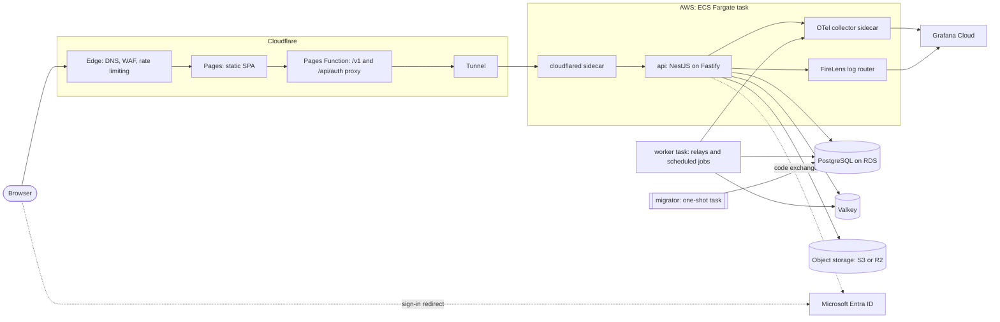
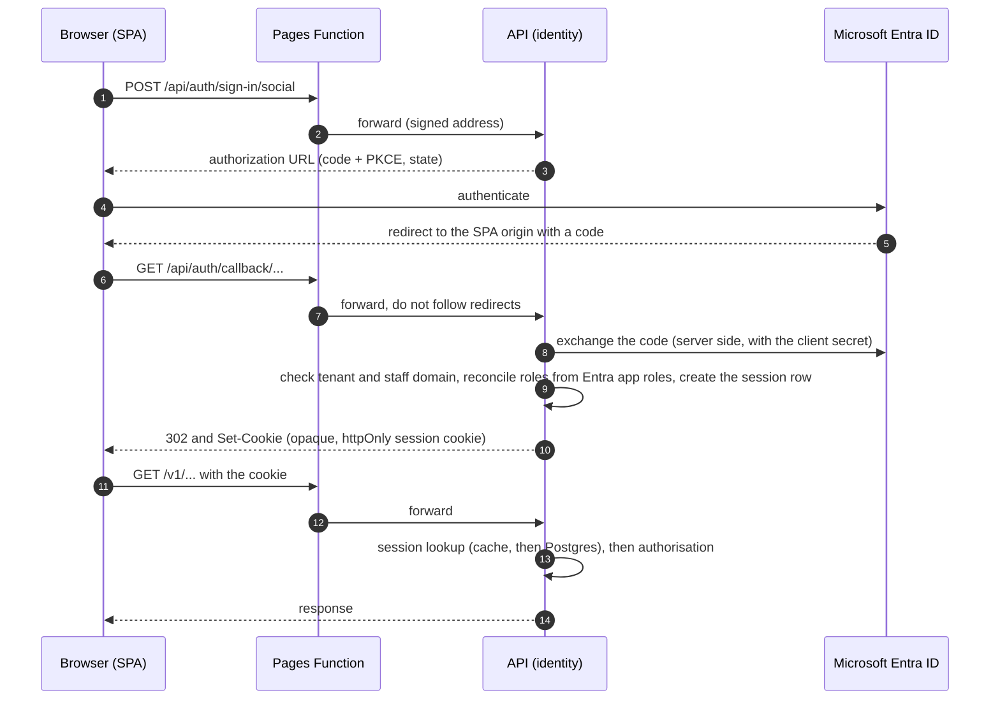
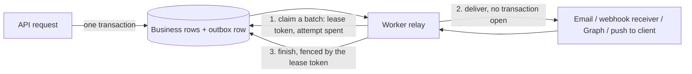
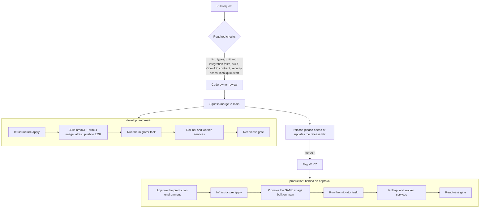

# QNSC Platform Architecture

How a request, a sign-in, a background job and a change travel through the QNSC engineering platform **today**.
The platform is a handful of internal products (Rova, OpsHub, the Knowledge Base) that share a small set of
application packages, CI workflows and infrastructure modules. For the technology behind each box see
[TECH_STACK.md](./TECH_STACK.md); for which repository owns what see [REPOSITORY_STRUCTURE.md](./REPOSITORY_STRUCTURE.md).

The diagrams describe Rova and OpsHub, which share one shape. The Knowledge Base differs where noted.

## The shape of it

There is **no load balancer**. Every request already arrives through Cloudflare, so the API task runs a `cloudflared`
sidecar that dials *out* to Cloudflare; nothing in the cloud accepts inbound connections from the internet.

## The request path

1. The browser loads the single-page app from **Cloudflare Pages**. Static assets never touch AWS.
2. The SPA calls **relative** paths (`/v1/...`, and `/api/auth/...` for sign-in). It is deliberately same-origin with
   its API: the session cookie is set on the SPA's own host and cannot be set cross-site. The SPA is never given the
   API's address.
3. A **Pages Function** receives those paths and proxies them to the API origin. It forwards an allow-list of request
   headers (never a visitor's own `x-forwarded-for` or Cloudflare headers), does **not** follow redirects (so the
   sign-in redirect and its `Set-Cookie` reach the browser untouched), and adds the visitor's real address signed with
   a shared key and a timestamp. A Function that is missing its origin or key answers 500 and names it; it never
   forwards unsigned.
4. The request travels the **Tunnel** to the `cloudflared` sidecar in the API task and reaches the API on localhost.
5. The API's `clientIp()` verifies the signature before it trusts the address, so the rate limiter, the access log and
   idempotency key on the real visitor, not on a Cloudflare address shared by everyone. If the signature is missing
   or wrong it falls back to the connecting address and counts a rejection, which alerts.
6. Mutating requests carry a CSRF token bound to the session. In OpsHub and Rova every route must declare how it is
   authorised, and a test fails the build for a route that does not.

Edge governance (WAF rules, rate limits, the zone's DNS) is zone-level and lives in the `infra` repository, not in any
product.

## Sign-in and sessions

Staff sign in with **Microsoft Entra ID**. The browser never holds a token: the API is a confidential OIDC client and
keeps the session on the server.

- **Sessions are database rows** behind one opaque cookie; Valkey caches them and Postgres is the source of truth, so a
  cache outage degrades but does not log anyone out.
- **Roles** come from Entra app roles and are reconciled at every sign-in; no role means the lowest one. Authorization
  decisions (what a role may do) live in the product, not in the identity package.
- **OpsHub** runs this flow on `identity` 8 (Better Auth). **Rova** runs the same idea on `identity` 7, a server-side
  BFF flow with its own opaque cookie. The **Knowledge Base** has its own account login with Entra configurable.
- **Local development and CI** use a passwordless test login that exists only when the process is not in production
  mode; configuration validation refuses it in production.

## Workers and outboxes

A request must never wait on email, a webhook or a call to Microsoft Graph, and must never lose one. Products write the
**intent** in the same database transaction as the business change, and a worker performs it afterwards.

- **Claim, deliver, finish.** A relay claims due rows (`FOR UPDATE SKIP LOCKED`), stamps a lease token and expiry, spends
  the attempt in SQL, then **commits** before calling anything external; no transaction is held open across a network
  call. The finish step only writes if the row still carries this relay's token, so a relay whose lease lapsed cannot
  overwrite the one that took over.
- **Retries and dead letters.** Failures back off per row; a row that exhausts its attempts is dead-lettered and a
  structured log field raises an alarm. A relay whose *claim* throws every pass alerts as well.
- **Staleness.** Outgoing webhooks older than a configurable age are expired, not sent: a late event looks fresh to its
  receiver.
- **Graph work is the worker's alone (OpsHub).** The API holds no Microsoft Graph credential; a request that needs Graph
  writes a task row and the worker performs it, so an API compromise cannot reach the directory.
- **Scheduled jobs** run under a cross-pod lock in Valkey, so any number of worker replicas divide the work instead
  of duplicating it. Wake-ups for notification delivery travel over Valkey pub/sub, with a timer as the backstop.
- The shared `platform-jobs` package (durable jobs on Postgres) is the planned successor to hand-written relays; no
  product depends on it yet.

The Knowledge Base uses Celery (workers and a scheduler) with Redis as the broker for its ingestion and embedding
work.

## How a change ships

- **Pull requests** run the product's CI. A single aggregate job (`Backend CI required`, `Web CI required`) is what the
  branch rules require, so a job that was skipped or cancelled fails the gate instead of passing it. The infrastructure
  plan is posted on the PR and refuses to delete or replace DNS and identity resources unless a human opts in.
- **`develop`** deploys on every merge to `main`: infrastructure first, then the image, the migration, the rollout and
  a readiness probe. The deploy waits for the infrastructure apply of the *same commit*, so an app never rolls ahead of
  the infrastructure it needs.
- **`production`** deploys from a release tag only. The image is the one built on `main`; nothing is rebuilt for
  production. A required reviewer approves the `production` environment before anything applies. A product's production environment
  can be provisioned but idle (services at zero tasks, cache disabled) until its go-live; the pipeline is the same.
- **Web** is built and published to Cloudflare Pages by a shared reusable workflow; the Pages project is an output of
  the product's infrastructure stack.
- **Database migrations** run as a gated one-shot task *before* traffic moves. Migrations must be backward compatible
  with the previous release for the minutes both run.
- **Shared code moves by version.** App packages go to GitHub Packages and reach products as one grouped Renovate PR;
  Terraform modules are pinned by git tag; workflows are pinned to the `ci` major version. A fix in a shared repository
  reaches every product through a normal, reviewed bump.

## Guardrails in one place

| Concern | How it is handled |
| :------ | :---------------- |
| Cloud credentials | None stored. GitHub Actions assume short-lived roles through OIDC; people use MFA-protected users that hold no permissions and assume short-lived roles |
| Secrets | Created empty by OpenTofu, set by a person out of band, injected into tasks by reference; never in state, code or logs |
| Database access | The application connects as a restricted role; migrations run as the owner; a CI job runs the whole test suite as the restricted role so a missing grant fails CI, not production |
| Supply chain | Immutable image tags, SLSA provenance attestation, image and dependency scans, workflow linting, pinned actions |
| Visibility | Telemetry and logs in Grafana Cloud; alarms for infrastructure signals in CloudWatch; every alert links to a runbook in the product repository |
| Blast radius | Each product has its own database, services and secrets bundle (develop shares one cache node, separated by database index and key prefix); shared pieces are code and modules, not runtime |
