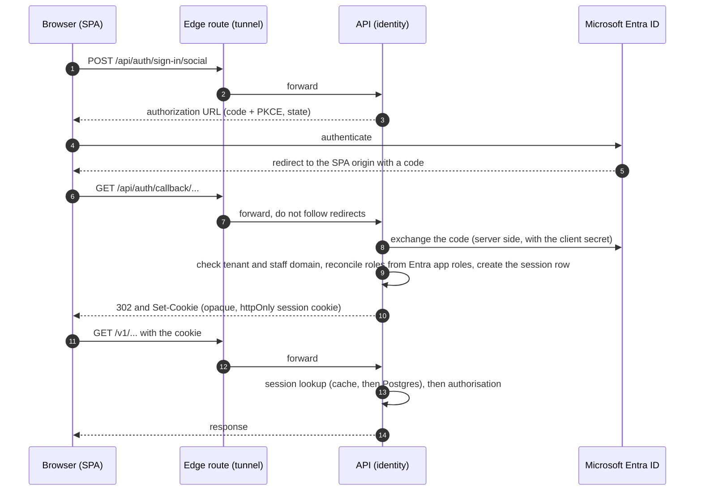
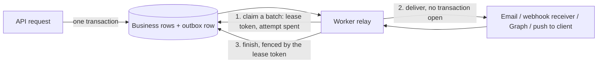
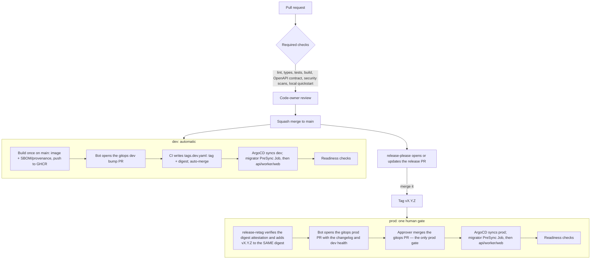

# QNSC Platform Architecture

How a request, a sign-in, a background job and a change travel through the QNSC engineering platform **today**.
The platform is a handful of internal products (Rova, OpsHub, the Knowledge Base) that share a small set of
application packages, CI workflows and infrastructure modules. For the technology behind each box see
[TECH_STACK.md](./TECH_STACK.md); for which repository owns what see [REPOSITORY_STRUCTURE.md](./REPOSITORY_STRUCTURE.md).

The diagrams describe Rova and OpsHub, which share one shape. The Knowledge Base differs where noted.

## The shape of it

```mermaid
flowchart LR
  user([Browser])
  subgraph cf[Cloudflare]
    edge[Edge: DNS, WAF, rate limiting, Access]
    tunnel[Tunnel]
  end
  subgraph k3s[On-prem Kubernetes (k3s)]
    argocd[ArgoCD: syncs the desired state]
    api[api: NestJS on Fastify]
    web[web: SPA served as an image]
    worker[worker: relays and scheduled jobs]
    migrator[[migrator: one-shot Job]]
    pg[(PostgreSQL: CNPG)]
    vk[(Valkey)]
    obj[(Object storage)]
  end
  ghcr[GHCR: images, digest-pinned]
  gitops[gitops repo: values and charts]
  graf[Grafana Cloud]
  entra[Microsoft Entra ID]
  kv[Azure Key Vault]

  user --> edge --> tunnel
  tunnel -->|/v1, /api/auth| api
  tunnel -->|everything else| web
  api --> pg
  api --> vk
  api --> obj
  worker --> pg
  worker --> vk
  migrator --> pg
  user -. sign-in redirect .-> entra
  api -. code exchange .-> entra
  api --> graf
  worker --> graf
  ghcr --> argocd
  gitops --> argocd
  argocd --> api
  argocd --> web
  argocd --> worker
  kv -->|External Secrets| api
```

There is **no cloud load balancer and no inbound firewall rule**. `cloudflared` dials *out* to Cloudflare from
inside the cluster, so nothing is exposed directly; the tunnel is the only ingress.


There is **no load balancer**. Every request already arrives through Cloudflare, so the API task runs a `cloudflared`
sidecar that dials *out* to Cloudflare; nothing in the cloud accepts inbound connections from the internet.

## The request path

1. The browser resolves a product host through **Cloudflare**. The edge routes `/v1/*`, `/api/auth/*` and a readiness
   path to the API and everything else to the web deployment, both over the same **tunnel**.
2. The SPA calls **relative** paths (`/v1/...`, `/api/auth/...`). It is deliberately same-origin with its API: the
   session cookie is set on the SPA's own host and cannot be set cross-site. The SPA is never given the API's address.
3. The request reaches the API pod from `cloudflared`; API services are ClusterIP-only. Sign-in is Entra ID; the
   browser holds no token, only an opaque session cookie.
4. Mutating requests carry a CSRF token bound to the session. In OpsHub and Rova every route must declare how it is
   authorised, and a test fails the build for a route that does not.

## Sign-in and sessions

Staff sign in with **Microsoft Entra ID**. The browser never holds a token: the API is a confidential OIDC client and
keeps the session on the server.



- **Sessions are database rows** behind one opaque cookie; Valkey caches them and Postgres is the source of truth, so a
  cache outage degrades but does not log anyone out.
- **Roles** come from Entra app roles and are reconciled at every sign-in; no role means the lowest one. Authorization
  decisions (what a role may do) live in the product, not in the identity package.
- **OpsHub** runs this flow on `identity` 8 (Better Auth). **Rova** runs the same idea on `identity` 7, a server-side
  BFF flow with its own opaque cookie. The **Knowledge Base** has its own account login with Entra configurable.
- **Local development and CI** use a passwordless test login that exists only when the process is not in production
  mode; configuration validation refuses it in production.

## Workers and outboxes

A request must never wait on email, a webhook or a call to Microsoft Graph, and must never lose one. Products write the
**intent** in the same database transaction as the business change, and a worker performs it afterwards.



- **Claim, deliver, finish.** A relay claims due rows (`FOR UPDATE SKIP LOCKED`), stamps a lease token and expiry, spends
  the attempt in SQL, then **commits** before calling anything external; no transaction is held open across a network
  call. The finish step only writes if the row still carries this relay's token, so a relay whose lease lapsed cannot
  overwrite the one that took over.
- **Retries and dead letters.** Failures back off per row; a row that exhausts its attempts is dead-lettered and a
  structured log field raises an alarm. A relay whose *claim* throws every pass alerts as well.
- **Staleness.** Outgoing webhooks older than a configurable age are expired, not sent: a late event looks fresh to its
  receiver.
- **Graph work is the worker's alone (OpsHub).** The API holds no Microsoft Graph credential; a request that needs Graph
  writes a task row and the worker performs it, so an API compromise cannot reach the directory.
- **Scheduled jobs** run under a cross-pod lock in Valkey, so any number of worker replicas divide the work instead
  of duplicating it. Wake-ups for notification delivery travel over Valkey pub/sub, with a timer as the backstop.
- The shared `platform-jobs` package (durable jobs on Postgres) is the planned successor to hand-written relays; no
  product depends on it yet.

The Knowledge Base uses Celery (workers and a scheduler) with Redis as the broker for its ingestion and embedding
work.

## Time: the database clock is the only clock for stored data

An API and its workers run on several hosts but share one database, so the database decides what time it is for
anything it stores or compares.

- **Stamping.** Timestamp columns are filled by the database: a column default (`now()`), or `now()` in the write
  itself. Application code does not pass `new Date()` (or `datetime.now()`) into an insert or update of a timestamp
  column. A value that comes from outside, such as a user-chosen due date or a provider's event time, is stored as
  given.
- **Comparing.** Anything compared with a stored timestamp uses `now()` inside the same SQL statement. This covers
  due and claim checks, leases and their expiry, retry back-off, report windows and their defaults, SLA deadlines,
  sweepers and retention cut-offs. When a response has to echo the bound it used, read it from the database
  (`SELECT now()`), never from the host.
- **Host clock.** Only for things that never meet a stored row: in-process timeouts, rate-limit windows held in
  Valkey, log lines and metrics.
- **Tests.** Faking the host clock does not move the database clock. A test that needs time to pass moves the rows'
  timestamps in the database instead, and every clock fix comes with a test that skews the host against the database
  and fails without the fix.

Why: in production the drift between hosts and the database is milliseconds, but when two clocks are mixed, rows go
missing from their own report, outbox rows wait a cycle, and leases expire early. One clock removes that whole class
of bug, and the rule stays the same on-prem.

## How a change ships




- **Pull requests** run the product's CI. A single aggregate job (`Backend CI required`, `Web CI required`) is what the
  branch rules require, so a job that was skipped or cancelled fails the gate instead of passing it. The infrastructure
  plan is posted on the PR and refuses to delete or replace DNS and identity resources unless a human opts in.
- **dev** deploys on every merge to `main`: the images are built once, scanned and attested, and a bot opens a gitops
  PR that sets the tag and digest in `values/<product>/tags.dev.yaml`; auto-merge moves ArgoCD. Nothing is rebuilt per
  environment.
- **prod** deploys from a release tag only, and the tag rebuilds nothing: CI verifies the digest's attestation and adds
  the version tag to the SAME digest, then opens a gitops prod PR with the changelog and the dev health. Merging that PR
  is the one approval. A product's prod Application can exist but stay idle until its go-live.
- **Web** is an image in the cluster, synced by ArgoCD like the API. The two landing sites stay on Cloudflare Pages.
- **Database migrations** run as an ArgoCD PreSync Job *before* traffic moves (expand/contract only, so a rollback
  revert is safe). A CNPG backup runs before a prod sync that contains a migration.
- **Shared code moves by version.** App packages go to GitHub Packages and reach products as one grouped Renovate PR;
  modules are pinned by git tag; workflows and actions are pinned to a full `ci` SHA with a `# vX.Y.Z` comment. A fix in
  a shared repository reaches every product through a normal, reviewed bump.

## Guardrails in one place

| Concern | How it is handled |
| :------ | :---------------- |
| Machine credentials | None stored. The on-prem estate has no cloud to authenticate to: CI reaches GHCR with the job token and gitops with a GitHub App token scoped to one repository |
| Secrets | Values live in Azure Key Vault and reach pods through External Secrets; OpenTofu owns shape and wiring, never values |
| Database access | The application connects as a restricted role; migrations run as the owner; a CI job runs the whole test suite as the restricted role so a missing grant fails CI, not production |
| Supply chain | Immutable image tags, SLSA provenance attestation, image and dependency scans, workflow linting, pinned actions |
| Visibility | Telemetry and logs in Grafana Cloud; ArgoCD and CNPG alerts; every alert links to a runbook in the product repository |
| Blast radius | Each product has its own database, workloads and secret bundle; shared pieces are code and modules, not runtime |
