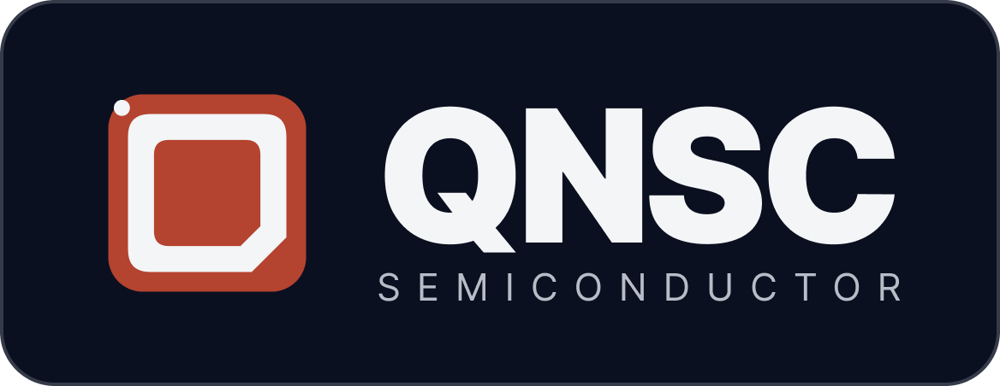

<!--
  BANNER: drop a 1280×360px PNG/SVG at  profile/assets/banner.png
  (suggested content: "QNSC — Quy Nhon Semiconductor" + tagline on a dark/branded background).
  Until the image exists, the alt text below shows as plain text — that's fine.
-->

# QNSC — Quy Nhon Semiconductor

**Design Service Today. Vietnamese Chips Tomorrow.**

A technology-driven **fabless semiconductor design center** with real in-house expertise
in front-end and back-end chip design, ASIC development, verification, and physical design.

---

## 🏢 About

**QNSC (Quy Nhon Semiconductor)** is a fabless IC design center based in Quy Nhon, Gia Lai
Province — Vietnam's rising semiconductor city. Backed by senior silicon architects with
25–40+ years across IBM, Meta, Intel, Samsung, TSMC, Arm, Synopsys, and Qualcomm, we deliver
end-to-end IC design and build a proprietary chip portfolio designed in Vietnam.

We operate in two streams:

| Stream | Focus |
| :----- | :---- |
| **A — Design Services** | End-to-end IC design outsourcing: Specs → Architecture → RTL → Verification → FPGA → GDSII → Bring-up → System |
| **B — Vietnamese Chips** | A proprietary chip portfolio: MCUs, IoT SoCs, and Secure Elements designed in-house |

> This GitHub organization hosts the **internal engineering platform** that runs QNSC —
> the software, infrastructure, and tooling our teams build to operate the company.

---

## 💻 What's in this organization

This org is where we build and run **QNSC's internal platform**. It is engineering tooling
for our own teams — not our silicon IP, which lives elsewhere.

| Project | What it is | Repositories |
| :------ | :--------- | :----------- |
| **Rova** | Work management: projects, work items, iterations, releases, test cases and portfolio reporting for planning chip-design and software delivery | [`rova`](https://github.com/quynhonsemiconductor/rova) |
| **OpsHub** | Internal IT and HR operations: assets, access requests, compliance, workforce, contracts, and security and quality records | [`opshub`](https://github.com/quynhonsemiconductor/opshub) |
| **Knowledge Base** | Enterprise knowledge search for our teams: hybrid retrieval over documents we ingest | [`qnsc-kb-backend`](https://github.com/quynhonsemiconductor/qnsc-kb-backend) · [`qnsc-kb-frontend`](https://github.com/quynhonsemiconductor/qnsc-kb-frontend) |
| **Shared platform** | The code every product reuses: application packages, CI workflows, infrastructure modules and platform infrastructure, GitOps for the Kubernetes estate | [`app-platform`](https://github.com/quynhonsemiconductor/app-platform) · [`ci`](https://github.com/quynhonsemiconductor/ci) · [`tf-modules`](https://github.com/quynhonsemiconductor/tf-modules) · [`infra`](https://github.com/quynhonsemiconductor/infra) · [`infra-template`](https://github.com/quynhonsemiconductor/infra-template) · [`gitops`](https://github.com/quynhonsemiconductor/gitops) |
| **Chip-design tooling** | An AI agent system for chip design, and a microcontroller built block by block as a training project | [`chipgraph`](https://github.com/quynhonsemiconductor/chipgraph) · [`vlsi_deep_training`](https://github.com/quynhonsemiconductor/vlsi_deep_training) |
| **Developer tools & web** | An MCP server for GitHub, Microsoft 365, Rova and a browser; the company marketing site | [`mcp-tools`](https://github.com/quynhonsemiconductor/mcp-tools) · [`qnsc-landing`](https://github.com/quynhonsemiconductor/qnsc-landing) |

New here? Start with the engineering docs in this repository:

- [`docs/ONBOARDING.md`](../docs/ONBOARDING.md) — access, toolchain, running a product locally, how a change ships
- [`docs/TECH_STACK.md`](../docs/TECH_STACK.md) — what we run, layer by layer
- [`docs/PLATFORM_ARCHITECTURE.md`](../docs/PLATFORM_ARCHITECTURE.md) — request path, sign-in, workers, deploy flow
- [`docs/REPOSITORY_STRUCTURE.md`](../docs/REPOSITORY_STRUCTURE.md) — which repository owns what

### On the roadmap
- 🎓 **Learning System** — structured onboarding & on-the-job training for our engineer pipeline

---

## 🛠️ Tech Stack

We build with **TypeScript** (NestJS and React) across the web and API, **Python** for the Knowledge Base,
**OpenTofu** for infrastructure on AWS and Cloudflare, and ship through **GitHub Actions** with shared reusable
workflows. See [`docs/TECH_STACK.md`](../docs/TECH_STACK.md).

---

## 🤝 Contributing & Standards

These are **internal QNSC repositories**. Contributions come primarily from QNSC engineers
and approved partners.

- 📜 **How to contribute** — see [`CONTRIBUTING.md`](../CONTRIBUTING.md) for branching, commit, and PR conventions shared across all QNSC repos.
- 🤝 **Code of Conduct** — all contributors follow our [`CODE_OF_CONDUCT.md`](../CODE_OF_CONDUCT.md).
- 👥 **Ownership** — reviews are routed per [`CODEOWNERS`](../.github/CODEOWNERS); new repos should copy this file as their starting point.
- ✅ **Reviews** — every PR needs at least one approving review from a code owner and passing CI before merge.
- 🐛 **Issues & PRs** — use the issue and pull-request templates provided by this `.github` repo.
- 🔒 **Security** — never commit secrets or credentials. Report security concerns privately (see [`SECURITY.md`](../SECURITY.md)).

---

## 📬 Contact

**Quy Nhon Semiconductor Company (QNSC)**

- 🌐 Website — [qnsc.vn](https://qnsc.vn)
- 📍 Address — Floor 1, Pisico Building, 99 Tay Son Street, Quy Nhon Nam Ward, Gia Lai Province, Vietnam
- ✉️ Email — `info@qnsc.vn`
- ☎️ Phone — +84 779 446 268
- 💼 Careers — [qnsc.vn](https://qnsc.vn) — we're growing our engineering team in Quy Nhon

---

*© 2026 QNSC — Quy Nhon Semiconductor. Building Vietnam's chip-design capability through real execution.*

